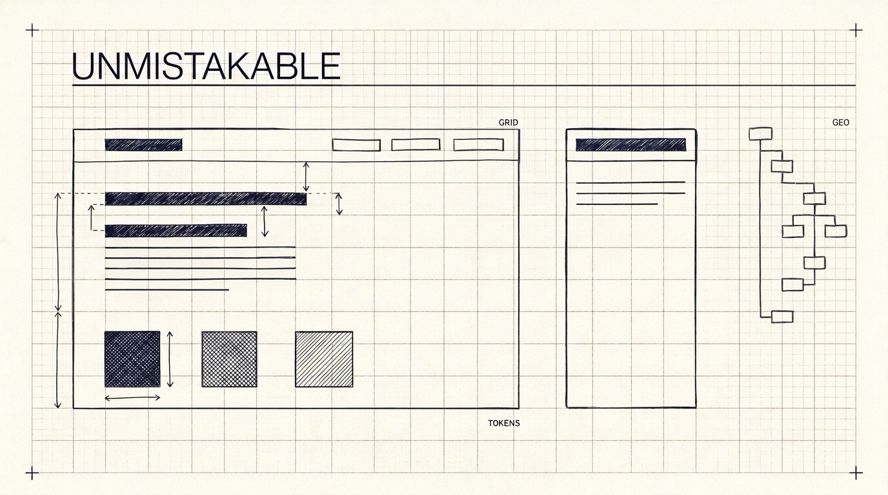

<div align="center">

# Unmistakable

**Stop shipping AI slop.**<br>
A design skill for coding agents that bans the purple gradients, neon glows, glass cards, and 50/50 heroes every model defaults to, keeps every icon and graphic in one visual language, then proves it with a 57-rule offline scanner.

[](https://github.com/AntonioCardenas/unmistakable/actions/workflows/ci.yml)
[](LICENSE)
[](references/commands-and-audit-rubric.md#deterministic-57-rule-catalog-unm-01-to-unm-57)
[](scripts/detect_slop.py)
[](#github-action)
[](https://github.com/AntonioCardenas/unmistakable/stargazers)

Works with **Claude Code**, **Cursor**, **Codex CLI**, **Gemini CLI**, **GitHub Copilot**, **Windsurf**, **OpenCode**, and **Google Antigravity**.

[Install](#install) · [What it bans](#what-it-bans) · [Scanner](#the-scanner) · [GitHub Action](#github-action) · [Commands](#commands) · [SEO and GEO](#seo-and-geo) · [FAQ](#faq)

*Read this in other languages: [English](README.md), [Español](README.es.md).*

</div>


<sub>Illustration of the two fixture pages in <a href="evals/fixtures/">evals/fixtures/</a>: the same product and facts, built once the way agents default and once with this skill. The finding counts are real; run the scanner on both yourself.</sub>

## Why this exists

Ask a coding agent for a landing page with no direction and you get the statistical average of its training data: dark slate, an indigo accent, purple-to-cyan gradient text, a pill that says "✨ New · AI-powered", a glowing button, a glass card floating next to the headline, "10K+ happy customers" that nobody counted, and three emoji feature cards. It looks fine for a second, and then it looks like everything else.

Unmistakable gives the agent taste rules it can follow and a scanner it cannot argue with:

- **Direction before pixels.** Every route gets a Visitor Mode (`Persuade`, `Operate`, `Read`, `Experience`) and a six-line Direction Contract, so dashboards open into work and landing pages commit to one idea.
- **One graphic language.** Icons, markers, dividers, data glyphs, spot art, and social cards all come from a named motif inventory in `DESIGN.md`, drawn with one stroke, one icon family, and theme colors. Nothing ships that the design system cannot name.
- **A flat, honest depth model.** Borders and surface steps instead of glows, gradients, glass, and stacked shadows. One neutral shadow token for things that actually float.
- **No invented facts.** No fabricated user counts, ratings, testimonials, or logos. Brand tokens come from your real site, screenshot, or code.
- **Proof, not adjectives.** 57 deterministic checks, an 18-gate ship checklist, SARIF output for GitHub code scanning, and a reusable GitHub Action. Python standard library only: no API keys, no network, no telemetry.
- **Search and AI answer visibility built in.** Valid JSON-LD, passage-level writing that answer engines quote, a robots.txt that keeps AI search while opting out of training, and honest guidance on `llms.txt`.

## Install

**Skills CLI** (Claude Code, Cursor, Codex, Gemini CLI, Copilot, Windsurf, OpenCode, Antigravity):

```bash
npx skills add AntonioCardenas/unmistakable
```

**Claude Code plugin:**

```text
/plugin marketplace add AntonioCardenas/unmistakable
/plugin install unmistakable@unmistakable
```

**Manual** (no Node required):

```bash
git clone https://github.com/AntonioCardenas/unmistakable ~/.claude/skills/unmistakable
# Codex, Gemini CLI, Antigravity, OpenCode: clone into .agents/skills/unmistakable/ in your project
```

Then ask your agent:

```text
/unmistakable build the pricing page
/unmistakable deslop src/app/page.tsx
/unmistakable audit
/unmistakable system https://your-site.com
/unmistakable seo
```

The skill also triggers on its own when you ask for UI work or say something "looks generic" or "looks AI-generated".

## What it bans

The full catalog with fixes and exceptions lives in [references/anti-patterns.md](references/anti-patterns.md). The highlights:

| AI tell | What to do instead | Rule |
|---|---|---|
| Tailwind `indigo-500` / `violet-500` as the accent | An accent derived from the product's real materials | `UNM-42` |
| Purple-to-cyan or purple-to-pink gradients | One committed solid field | `UNM-07` |
| Gradients on buttons, backgrounds, borders, icon tiles | Solid semantic tokens | `UNM-41` |
| Gradient headline text | Weight, scale, or one solid accent word | `UNM-03` |
| Neon glow halos and colored shadows | `1px` border plus a solid fill; neutral shadows on floating layers only | `UNM-06`, `UNM-43` |
| Heavy or stacked shadows on resting cards | Borders and surface tint steps | `UNM-44` |
| Glassmorphism panels | Opaque surfaces with a hairline | `UNM-45` |
| Blurred orbs and aurora blobs | Real imagery or a committed color field | `UNM-46` |
| Floating, bobbing, pulsing idle animation | Motion only in response to input or real state | `UNM-47` |
| Eyebrow pill above the headline | Start with the heading | `UNM-01` |
| "Trusted by 10,000+", "4.9★", "10K+ happy customers" | Sourced numbers, or nothing | `UNM-50` |
| "Elevate", "seamless", "supercharge", "reimagined" | A concrete capability with a number | `UNM-09` |
| Six corner radii and `z-index: 9999` on one screen | Three radius tokens and a named layer scale | `UNM-48`, `UNM-49` |
| `href="#"` everywhere | Real routes, or `<button>` | `UNM-53` |
| Emoji as icons and bullets (✨ ⚡ ✅) | One SVG icon family from `DESIGN.md` | `UNM-32` |
| `lucide` next to `react-icons` next to Font Awesome | One icon family per product | `UNM-56` |
| Icons in four stroke weights and five sizes, hex colors baked in | `--stroke-icon`, three sizes, `currentColor` | `UNM-54`, `UNM-55` |
| unDraw, Storyset, and other stock illustration packs | Spot art built from your own motif inventory | `UNM-57` |
| `50/50` split hero with a stat strip | A Visitor-Mode opening | `critique` |

Brand genuinely violet? Keep it. Every rule can be waived per line or per file with a written reason, and `--report-unused-ignores` catches stale waivers.

## The scanner

`scripts/detect_slop.py` reads HTML, JSX, TSX, Vue, Svelte, Astro, Angular templates, CSS, and SCSS. It understands inline styles, JSX style objects, and Tailwind utilities (`from-purple-500`, `shadow-indigo-500/50`, `backdrop-blur-xl`, `blur-3xl`, `rounded-2xl`, `z-[9999]`).

```console
$ cd evals/fixtures && python3 ../../scripts/detect_slop.py slop-landing.html
Unmistakable Scan: 1 file(s) | P0=4 P1=11 P2=37 P3=3
  ...
  [P2] UNM-46 slop-landing.html:15 - Blurred decorative orb or aurora blob (filter: blur >= 40px) (blur(120px).)
       Fix: Delete ambient blobs; let real product imagery, type scale, or a committed color field carry the atmosphere.
  [P2] UNM-42 slop-landing.html:16 - Stock AI purple accent (Tailwind indigo/violet/purple 400-700 or equivalent) (16 stock indigo/violet/purple reference(s) in file.)
       Fix: Derive the accent from the product's real materials in DESIGN.md; waive with a reason only when the brand genuinely pins this hue.
  [P2] UNM-07 slop-landing.html:25 - Purple-to-blue/cyan/pink AI cliche gradient
       Fix: Derive palette colors from the brand's real domain materials and DESIGN.md tokens; use one solid field.
  [P2] UNM-43 slop-landing.html:30 - Colored shadow or glow (chromatic box-shadow, text-shadow, or drop-shadow)
       Fix: Keep shadows neutral and only on floating layers; show emphasis with solid fill, weight, or a 1px border instead of a colored halo.
  [P2] UNM-50 slop-landing.html:79 - Unverified social-proof filler (Trusted by 10,000+, Join 50k+, five-star strings) ('Trusted by 10,000+'.)
       Fix: Show only sourced numbers and named customers with permission, or remove the claim; never invent counts, ratings, or logos.
  ...

$ python3 ../../scripts/detect_slop.py unmistakable-landing.html
Unmistakable Scan: 1 file(s) | P0=0 P1=0 P2=0 P3=0
  Clean: zero findings.
```

```bash
python3 scripts/detect_slop.py src/                      # human-readable report with fixes
python3 scripts/detect_slop.py src/ --fail-on P1         # exit 2 only for P0/P1 findings
python3 scripts/detect_slop.py src/ --json               # machine-readable for agents
python3 scripts/detect_slop.py src/ --sarif > out.sarif  # GitHub code scanning
python3 scripts/detect_slop.py --list-rules              # all 57 rules
python3 scripts/check_foundations.py .                   # 18 ship-readiness gates
```

Rules span seven families: anti-slop visuals (`UNM-01` to `UNM-08`, `UNM-41` to `UNM-47`), micrographic coherence (`UNM-32`, `UNM-54` to `UNM-57`), copy and invented proof, typography, sloppy craft, accessibility and Core Web Vitals, and technical SEO and GEO. Severity runs from `P0` (blocking) to `P3` (polish). The full catalog is in [references/commands-and-audit-rubric.md](references/commands-and-audit-rubric.md#deterministic-57-rule-catalog-unm-01-to-unm-57).

## GitHub Action

Gate pull requests and annotate the diff with findings:

```yaml
name: UI quality
on: [pull_request]
permissions:
  contents: read
  security-events: write
jobs:
  unmistakable:
    runs-on: ubuntu-latest
    steps:
      - uses: actions/checkout@v4
      - uses: AntonioCardenas/unmistakable@v1
        with:
          path: src
          fail-on: P1
      - uses: github/codeql-action/upload-sarif@v3
        if: always()
        with:
          sarif_file: unmistakable.sarif
          category: unmistakable
```

Inputs: `path` (default `.`), `fail-on` (`P0` to `P3`, default `P1`), and `sarif-file` (default `unmistakable.sarif`). Runs on Linux and macOS runners with the preinstalled `python3`.

## Commands

Invoke `/unmistakable <command> [target]` (`$unmistakable` in Codex). With no command the skill picks the narrowest workflow.

| Group | Commands |
|---|---|
| **System and setup** | `init` writes `PRODUCT.md` · `system [ref]` extracts a brand from a URL, screenshot, or code into `DESIGN.md`, `design/tokens.css`, `design/design-system.html`, and a 1-page `design/brand-book-a4.pdf` · `document` reverse-engineers existing CSS · `extract` pulls repeated values into tokens |
| **Build and steer** | `shape` writes the Direction Contract · `build` ships a page or workspace end to end · `deslop` strips AI tells · `graphics` unifies icons and micrographics · `typeset` · `layout` · `colorize` · `animate` · `bolder` · `quieter` · `distill` |
| **Evaluate** | `audit` scores six dimensions (`0-24`) with `P0-P3` findings and `file:line` evidence, without editing · `critique` runs the memory, competitor-swap, squint, and tell-count tests |
| **Harden and ship** | `harden` (overflow, RTL, `Intl`, error states, gestures) · `optimize` (`LCP`, `INP`, `CLS`) · `seo` (head contract, JSON-LD, GEO passages, crawler access) · `foundations` (18 gates) · `polish` (final zero-defect pass) |

## Living design systems and A4 brand books

`/unmistakable system https://your-site.com` extracts real colors, fonts, the exact SVG logo, and documented principles. It never invents a tagline or redraws a logo. It also records the graphic language: icon family, stroke, sizes, and the motif inventory every future icon, divider, and illustration must come from. The output is a token file any framework can import, a scrollable `design-system.html` with live specimens and states, and a print-exact single-page A4 brand book rendered by headless Chrome, Chromium, Brave, or Edge.



<sub>This repository follows its own system: every asset uses the drafting-sheet language in <a href="DESIGN.md">DESIGN.md</a>.</sub>

## SEO and GEO

Public pages ship ready for both classic search and AI answer engines (ChatGPT search, Perplexity, Google AI Overviews, Copilot, Claude, Gemini):

- **Content in the initial HTML.** Most AI crawlers do not run JavaScript, so primary copy, prices, tables, and JSON-LD render on the server or at build time.
- **Passages that get quoted.** Answer-first paragraphs under question-shaped headings, self-contained sections that name the entity, definition sentences, and semantic tables. The GEO research (Aggarwal et al., KDD 2024) found citations, quotations, and statistics raise visibility in generative answers; keyword stuffing does not.
- **Valid structured data.** `@graph` JSON-LD that matches the visible page, with invalid JSON and missing `@context` caught by `UNM-51`.
- **AI crawler access you choose on purpose.** A user-agent matrix that separates search, user-triggered fetch, and training bots, a robots.txt that keeps AI search while opting out of training, and a foundations gate that fails when robots.txt blocks answer engines. It also reminds you to check the CDN, because a WAF `403` overrides any `Allow`.
- **Honest `llms.txt` guidance.** It is a proposal that coding agents and docs tools read, not a ranking lever. Ship it as cheap insurance and do not expect more.
- **Measurement.** AI referrer segments, `utm_source=chatgpt.com`, bot fetches in server logs, and a monthly prompt panel.

Details: [references/seo-and-geo-patterns.md](references/seo-and-geo-patterns.md).

## How it compares

| | Prompt-only design rules | Unmistakable |
|---|---|---|
| Taste guidance | Adjectives ("make it modern") | Visitor Modes, a Direction Contract, a depth model, and a 60-second slop review |
| Enforcement | None | 57 deterministic rules, `--fail-on`, SARIF, a GitHub Action |
| Graphic coherence | None | Motif inventory, one icon family, token strokes and sizes, `icon-system` gate |
| Tailwind awareness | Rarely | Gradient stops, colored shadows, `backdrop-blur`, `blur-3xl`, radius and `z-[]` drift |
| Design-system output | None | `DESIGN.md`, `tokens.css`, `design-system.html`, A4 PDF |
| SEO and GEO | Meta tags at best | Head contract, JSON-LD validation, passage writing, crawler gate |
| Runtime | Not applicable | Python standard library, offline |

Unmistakable complements accessibility and performance tools like axe and Lighthouse. It catches the taste-level and content-level tells they do not look for.

## FAQ

### What is Unmistakable?
Unmistakable is an open-source agent skill that teaches coding agents to build web interfaces with a committed visual direction instead of the default AI look. It ships a 57-rule offline scanner, an 18-gate ship checklist, design-system and brand-book generators, and technical SEO plus GEO patterns. It is MIT licensed.

### Which coding agents does it work with?
Any agent that loads `SKILL.md` skills: Claude Code, Cursor, Codex CLI, Gemini CLI, GitHub Copilot, Windsurf, OpenCode, and Google Antigravity. The scanner and checklist are plain Python, so they also run in any CI system or pre-commit hook.

### Does it work with Tailwind, Next.js, Astro, Vue, Svelte, and Angular?
Yes. Tokens are standard CSS custom properties that map into Tailwind v4 `@theme`, and the scanner reads `.tsx`, `.jsx`, `.vue`, `.svelte`, `.astro`, `.html`, `.css`, and `.scss`, including Tailwind utility classes.

### My brand is purple. Will it fight me?
No. The rules target defaults, not decisions. Record the brand color in `DESIGN.md` and waive the rule once at file level with a reason, for example `/* unmistakable-disable-file UNM-42: brand primary is violet */`.

### Does it need an API key, a binary download, or network access?
No. Every script uses the Python 3.8+ standard library, runs offline in milliseconds, and sends no telemetry. Only brand-book PDF rendering needs a local Chromium-based browser.

### Does `llms.txt` improve rankings in ChatGPT or Google?
There is no evidence that it does. Google has said it does not use `llms.txt` for Search, and no major answer engine has committed to it. Coding agents and documentation tools do read it, so it is worth shipping for docs and developer tools. What measurably helps AI citation is server-rendered content, answer-first passages, sourced statistics, and valid structured data.

## Contributing

Spotted an AI tell the scanner misses? Open a [new slop pattern](https://github.com/AntonioCardenas/unmistakable/issues/new?template=new-slop-pattern.yml) issue with a screenshot and the markup. Hit a false positive? Use the [false positive](https://github.com/AntonioCardenas/unmistakable/issues/new?template=false-positive.yml) template. Every rule ships with a positive test and a false-positive guard. See [CONTRIBUTING.md](CONTRIBUTING.md).

```bash
npm test   # unit tests, fixture checks, and skill-structure validation
```

## Repository structure

```text
unmistakable/
├── SKILL.md                          # Router, standing rules, workflows
├── DESIGN.md                         # This repo's own drafting-sheet design system
├── action.yml                        # Reusable GitHub Action (SARIF + severity gate)
├── references/
│   ├── anti-patterns.md              # The AI-slop catalog and 60-second review
│   ├── micrographics.md              # One graphic language: icons, motifs, spot art
│   ├── agnostic-design-patterns.md   # Visitor modes, tokens, type, motion, craft floor
│   ├── brand-and-design-system.md    # Evidence-first extraction, HTML and A4 outputs
│   ├── production-hardening.md       # Overflow, RTL, Intl, gestures, WCAG 2.2, CWV
│   ├── seo-and-geo-patterns.md       # Head contract, JSON-LD, GEO, AI crawlers, llms.txt
│   └── commands-and-audit-rubric.md  # 20 command playbooks, audit rubric, 57-rule catalog
├── scripts/
│   ├── detect_slop.py                # 57-rule scanner (text, JSON, SARIF)
│   ├── check_foundations.py          # 18 ship-readiness gates
│   └── render_brand_book.py          # Headless-browser A4 PDF renderer
├── assets/                           # Templates and drafting-sheet images (with prompt sidecars)
├── evals/                            # Tests, before/after fixtures, trigger evals
├── llms.txt                          # Index for AI agents
└── llms-full.txt                     # Single-fetch reference for AI agents
```

## Credits

Built with the methodology of [robonuggets/skill-creator-plus](https://github.com/robonuggets/skill-creator-plus), extending ideas from [google-gemini/demolab](https://github.com/google-gemini/demolab/blob/main/skills/gemini-frontend-design/SKILL.md) (opening-screen formats, 2-family and 3-size type), [robonuggets/design-system](https://github.com/robonuggets/design-system) (evidence-first extraction and A4 brand books), and [pbakaus/impeccable](https://github.com/pbakaus/impeccable) (visitor modes, steering commands, craft floor, and slop detection).

## License

MIT. See [LICENSE](LICENSE).
